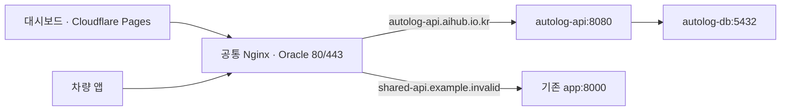

# AutoLog 배포·운영 안내

이 폴더는 **Oracle에서 AutoLog API와 PostgreSQL만 운영**하는 설정입니다. 차량 앱은 APK로 배포하고, 관리자 대시보드는 Cloudflare Pages에서 배포합니다. 공용 Nginx·도메인·인증서는 `shared-infrastructure` 리포가 관리합니다.

## 현재 준비 범위

- 운영 API 주소: `https://autolog-api.aihub.io.kr`.
- 공통 Nginx는 `shared-proxy` 네트워크의 **`autolog-api:8080`**으로 전달합니다.
- 기존 shared-infrastructure API는 별도 Compose 프로젝트에서 **8000**을 사용합니다.
- 이 폴더는 배포 파일과 workflow를 준비한 것이며, 파일 추가만으로 운영 API·DB를 실행하지 않습니다.
- 서버에는 계약 문서의 1차 API 24개(관리자 로그인, 페어링·기기, 운행 업로드·수정·조회, 월간 집계, 기록부 XLSX, 차량·직원·장소), Flyway `V1` 스키마, 관리자 JWT·기기 토큰 인증, CORS, 회사·관리자 시드가 구현돼 있습니다. 2차 범위(월 마감, SSE, PDF 등)는 없습니다.

앱 동작과 데이터 모델의 기준은 [계약 문서](../docs/contracts/README.md), [인증·동작 규칙](../docs/contracts/rules.md), [DB 계약](../docs/contracts/database.md)입니다. `docs/`의 Pleos 원문 아카이브는 SDK 참고 자료입니다.

## 구조와 관리 경계



| 구분 | AutoLog에서 관리 | 공통 Nginx 리포에서 관리 |
| --- | --- | --- |
| 실행 | API·PostgreSQL, `autolog` Compose 프로젝트 | Nginx 80·443, `shared-infrastructure` Compose 프로젝트 |
| 배포 위치 | `~/autolog-hyundai-2026/` | `~/shared-infrastructure/` |
| 네트워크 | API는 전용 DB 네트워크 + `shared-proxy`, DB는 전용 네트워크만 | `shared-proxy` 생성과 Nginx 연결 |
| 외부 연결 | API 도메인으로 요청하는 클라이언트 설정·CORS | 도메인 라우팅, HTTPS 인증서·갱신 |
| 데이터 | `autolog_autolog-db` 볼륨, 백업, Flyway | 공통 인증서 파일 |

API·DB에는 호스트 `ports` 매핑이 없습니다. 내부 8080·5432를 사용하며 Nginx가 API에 접근합니다. 서비스 이름 `autolog-api`, 포트 8080, 네트워크 `shared-proxy`를 바꾸면 공통 Nginx 설정도 함께 수정해야 합니다. 평소 이미지 갱신에는 Nginx 변경이 필요 없습니다.

## 파일 안내

| 파일 | 역할 |
| --- | --- |
| `compose.yaml` | 운영 API·DB·영속 볼륨·healthcheck·자원/로그 상한 |
| `deploy.sh` | 사전 검사 → 이미지 pull → 상태 확인 → 성공 버전 기록 / 실패 시 이전 이미지 복구 |
| `env.example` | 서버 `.env`에 필요한 변수의 이름과 설명. 비밀값 없음 |
| `tests/deploy.test.mjs` | 실제 Docker/서버에 접속하지 않고 배포 성공·실패·복구 경계를 검증 |
| [`server/Dockerfile`](../server/Dockerfile) | Java 25 bootJar 빌드 → ARM64용 non-root JRE 이미지 |
| [`server/.dockerignore`](../server/.dockerignore) | 이미지에 보내지 않을 로컬 파일·비밀값 |
| [`application-prod.yaml`](../server/src/main/resources/application-prod.yaml) | 프록시 헤더·종료 대기·운영 health 노출 설정 |
| [`deploy-server.yml`](../.github/workflows/deploy-server.yml) | 서버 테스트, ARM64 이미지 빌드·GHCR 발행, 선택적 Oracle 배포 |
| [`server-host-key.pub`](../.github/server-host-key.pub) | Oracle SSH 호스트의 **공개키**. 배포 개인키가 아님 |

`server/compose.yaml`은 로컬 PostgreSQL용이므로 운영에서는 이 폴더의 `compose.yaml`을 사용합니다. API 이미지 안에는 DB 비밀번호·JWT 키가 없으며 서버의 `.env`에서 런타임에 전달합니다.

## 최초 설정

### 1. GitHub 설정

이 리포의 Settings → Secrets and variables → Actions에서 확인합니다.

| 종류 | 이름 | 의미 |
| --- | --- | --- |
| Secret | `SSH_HOST` | 같은 Oracle 인스턴스의 주소 |
| Secret | `SSH_USER` | SSH 사용자 (`ubuntu`) |
| Secret | `SSH_PRIVATE_KEY` | 배포용 개인키. 앞서 기존 리포에서 이 세 항목을 복사함 |
| Variable | `AUTOLOG_DEPLOY_ENABLED` | `true`일 때만 main push 후 자동으로 실제 배포. 최초 설정 전에는 비워둠 |

GHCR은 workflow의 `GITHUB_TOKEN`을 사용하므로 별도 DockerHub 비밀번호는 필요 없습니다. workflow가 `packages: write/read` 권한을 요청합니다. 패키지를 기존에 수동 생성했다면 GHCR 패키지 설정에서 이 리포의 Actions 접근을 허용했는지 확인하세요.

`.github/server-host-key.pub`는 확인된 Oracle 공개 호스트키입니다. 서버를 재설치해 호스트키가 바뀌면 신뢰할 수 있는 경로에서 새 지문을 확인한 뒤 이 파일을 교체합니다. CI가 임의로 `ssh-keyscan` 결과를 신뢰하도록 바꾸지 않습니다.

### 2. 서버의 배포 폴더·환경변수 준비

서버에는 Bash, Docker Engine/Compose(`up --wait --wait-timeout` 지원), curl, flock이 필요합니다. `ubuntu`가 Docker를 실행할 수 있어야 합니다. 공통 설정 작업에서 `shared-proxy`는 이미 생성했습니다.

로컬에서 배포 파일만 먼저 복사합니다. 아래 `SERVER`는 자신의 접속 설정에 맞게 바꾸세요. 필요하면 ssh/scp에 `-i /path/to/key`를 지정합니다.

```sh
SERVER=ubuntu@your-oracle-host
ssh "$SERVER" 'install -d -m 700 ~/autolog-hyundai-2026'
scp deploy/compose.yaml deploy/deploy.sh deploy/env.example deploy/README.md \
  "$SERVER":~/autolog-hyundai-2026/
ssh "$SERVER"
```

이후 명령은 **서버**에서 실행합니다.

```sh
cd ~/autolog-hyundai-2026
cp env.example .env
chmod 600 .env
nano .env
```

| 변수 | 설정 기준 |
| --- | --- |
| `DB_NAME`, `DB_USERNAME` | 최초 기본값 `autolog`. 볼륨 초기화 후 변경은 DB 안의 계정·DB도 별도로 관리해야 함 |
| `DB_PASSWORD` | 반드시 채움. `openssl rand -hex 32` 등으로 생성한 별도 값. 기존 볼륨의 DB 비밀번호는 `.env`만 바꿔도 자동 변경되지 않음 |
| `JWT_SECRET` | 계약상 HS256 서명 키, 32바이트 이상. DB 비밀번호와 다른 값으로 생성 |
| `CORS_ALLOWED_ORIGINS` | 실제 대시보드 origin들과 `http://localhost:5173`을 쉼표로 구분. 경로나 마지막 `/` 없음. 비어 있으면 서버가 시작하지 않음 |
| `JWT_EXPIRES_HOURS` | 선택, 기본 12. 관리자 JWT 만료 시간 |
| `CONSENT_VERSION` | 선택, 기본 `2026-11-01`. 동의 문서를 바꾸면 올림 |
| `SEED_ORG_NAME`, `SEED_BIZ_REG_NO`, `SEED_ADMIN_LOGIN_ID`, `SEED_ADMIN_PASSWORD` | 네 값이 모두 있을 때만 서버 시작 시 회사·관리자를 만듦. 같은 사업자등록번호가 이미 있으면 아무것도 바꾸지 않음. 형식(`000-00-00000`, 이메일)이 틀리면 시작 실패 |
| `SEED_ADMIN_DISPLAY_NAME` | 선택, 기본 `관리자` |
| `API_MEMORY_LIMIT`, `API_CPUS` | 시작 기본값 1536m / 1.0 CPU. 실제 사용량을 보고 조정 |
| `DB_MEMORY_LIMIT`, `DB_CPUS` | 시작 기본값 512m / 0.5 CPU. PostgreSQL 성능·사용량을 보고 조정 |
| `JAVA_TOOL_OPTIONS` | 선택. heap 70% 외에 metaspace·thread stack 등 native 메모리 공간을 남겨둠 |

첫 배포는 `SEED_*`를 채워 회사·관리자를 만들고, 대시보드 로그인을 확인한 뒤 `SEED_ADMIN_PASSWORD`를 지워도 됩니다(이미 만든 계정은 유지). 심사용 회사·계정은 `SEED_*` 값을 바꿔 다시 시작해 만듭니다. 관리자 비밀번호 변경 API는 1차 범위 밖입니다.

dotenv 값에 `$`, `#` 등 문자가 있으면 작은따옴표로 감쌉니다. 이 파일을 `source`로 실행하지 않습니다. `.env`는 서버에 보관하며 Actions가 매번 덮어쓰지 않습니다. 비밀값이 보이는 `docker compose config` 전체 출력도 CI에 남기지 않습니다.

### 3. 첫 배포와 자동 배포 활성화

1. 이 파일들과 서버 코드를 GitHub에 반영합니다. main push는 서버 테스트와 ARM64 이미지 발행까지 수행합니다.
2. Actions → **AutoLog API build and deploy** → Run workflow에서 main을 선택하고 `deploy=true`로 실행합니다.
3. 배포와 공개 health 확인이 성공한 뒤 `AUTOLOG_DEPLOY_ENABLED=true`를 설정하면 이후 서버·deploy 파일의 main 변경마다 실제 배포합니다.

PR은 테스트·이미지 빌드만 수행하고, 이미지 발행·SSH 배포를 하지 않습니다. 대시보드 변경만으로는 서버 workflow가 실행되지 않습니다. 서버 테스트 실패 시 이미지 발행·배포 단계로 넘어가지 않습니다.

CI 순서는 다음과 같습니다.

```text
서버 테스트 + 배포 스크립트 검사
  → linux/arm64 이미지 빌드
  → ghcr.io/chabinhwang/autolog-api:<커밋 SHA> 발행
  → 이 빌드의 sha256 digest로 배포 이미지 고정
  → 배포 파일 4개만 SSH 전송 (.env, .state, DB 볼륨 보존)
  → AutoLog 전용 임시 Docker 로그인
  → API 이미지 pull, Compose 기동, 내부 health 대기
  → 공개 /actuator/health 확인
  → 성공 이미지 기록 또는 이전 이미지 복구
  → 임시 registry 자격 증명 삭제
```

shared-infrastructure Actions도 같은 SSH 사용자를 쓰므로, registry 로그인은 임시 `DOCKER_CONFIG`로 분리합니다. 이 배포가 다른 리포의 `~/.docker/config.json`을 덮어쓰거나 로그아웃시키지 않습니다. `.deploy.lock`은 수동 실행과 CI 실행의 겹침도 방지합니다.

## 서버에서 수동 배포

첫 실행에는 40자리 커밋 SHA 태그 또는 GHCR digest를 지정해야 합니다. `latest`는 허용하지 않습니다.

```sh
cd ~/autolog-hyundai-2026
# 다음 값의 마지막 부분을 GHCR에 발행된 실제 커밋 SHA 40자리로 바꿉니다.
IMAGE='ghcr.io/chabinhwang/autolog-api:여기에_40자리_커밋_SHA'
AUTOLOG_API_IMAGE="$IMAGE" bash ./deploy.sh
```

private GHCR 이미지는 pull 권한이 필요합니다. CI는 자동 처리합니다. 수동으로 한 번만 로그인하려면 읽기 권한 토큰을 **표준입력**으로 전달할 수 있습니다.

```sh
read -rs GHCR_READ_TOKEN
printf '%s' "$GHCR_READ_TOKEN" | \
  AUTOLOG_GHCR_USERNAME=chabinhwang \
  AUTOLOG_API_IMAGE="$IMAGE" \
  bash ./deploy.sh
unset GHCR_READ_TOKEN
```

이전 성공 이미지가 기록된 뒤에는 `bash ./deploy.sh`로 같은 버전을 다시 배포할 수 있습니다. private 이미지의 registry 인증은 여전히 필요합니다. PostgreSQL 이미지는 첫 설치에만 가져오며, 일반 API 배포에서 기존 DB 이미지를 자동 갱신하지 않습니다.

## 상태·로그·장애 확인

모두 서버 `~/autolog-hyundai-2026/`에서 실행합니다.

```sh
docker compose ps
docker compose logs --tail 100 -f autolog-api
docker compose logs --tail 100 autolog-db
docker compose exec -T autolog-api curl -fsS http://127.0.0.1:8080/actuator/health
curl -fsS https://autolog-api.aihub.io.kr/actuator/health
docker stats --no-stream
tail -n 10 .state/history.tsv
```

| 증상 | 확인할 곳 |
| --- | --- |
| `/nginx-health`도 실패 | DNS·Cloudflare·공통 Nginx·인증서. shared-infrastructure 쪽에서 확인 |
| `/nginx-health` 200, API는 503 | API 미배포/미기동, 공유 네트워크·서비스 이름·8080 확인 |
| 내부 health 200, 공개 health 실패 | Nginx가 `shared-proxy`에 연결되어 있는지, API DNS 별칭, Cloudflare 응답 확인 |
| DB unhealthy | `.env`, DB 로그, 볼륨 권한·디스크 여유 확인 |
| API 시작 시 Flyway/JPA 오류 | 마이그레이션·DB 계약 확인. 운영은 `ddl-auto: validate`이며 자동 테이블 생성하지 않음 |
| 브라우저에서만 실패 | API URL, preflight OPTIONS, `CORS_ALLOWED_ORIGINS` 소비 코드 확인 |
| SSH 호스트키 실패 | 고정 공개키와 서버 지문을 확인. 검증을 끄지 않음 |
| GHCR pull 401/403 | 패키지에 대한 이 리포의 Actions 접근·토큰 packages 권한 확인 |

healthcheck는 실패를 표시하며, Docker가 unhealthy 컨테이너를 자동 재시작해 주는 것은 아닙니다. `restart: unless-stopped`는 프로세스 종료 시 재시작 정책입니다. 배포 스크립트가 health 실패를 감지해 복구를 시도합니다.

서버 로그는 계약 문서의 원칙대로 토큰·장소 라벨·메모를 출력하지 않도록 구현해야 합니다. workflow는 서버 로그 본문을 자동 수집하지 않습니다.

## 이미지 롤백과 DB 보존

```sh
cd ~/autolog-hyundai-2026
test -s .state/previous-image
AUTOLOG_API_IMAGE="$(cat .state/previous-image)" bash ./deploy.sh
```

- 현재/이전 성공 이미지: `.state/current-image`, `.state/previous-image`.
- 배포 이력: `.state/history.tsv`.
- 새 배포 실패 시 이전 이미지가 있으면 되돌리고 health를 기다립니다. 최초 배포 실패 시 API만 중지하고 DB·볼륨은 남깁니다.
- 이미지 복구는 **DB schema·데이터를 되돌리지 않습니다**. Flyway 변경은 이전 앱과 호환되도록 설계하고 별도 DB 백업을 준비합니다.
- DB 데이터는 `autolog_autolog-db` 볼륨에 남습니다. `docker compose down -v`는 이 데이터를 삭제하므로 일반 배포·복구에 사용하지 않습니다.

백업 예시:

```sh
umask 077
mkdir -p backups
docker compose exec -T autolog-db sh -c \
  'pg_dump -U "$POSTGRES_USER" -d "$POSTGRES_DB" -Fc' \
  > "backups/autolog-$(date -u +%Y%m%dT%H%M%SZ).dump"
```

백업 파일에는 업무·개인정보가 들어갈 수 있습니다. 별도 보관 위치와 복구 절차를 운영 시 정하고, 실제 DB 변경 전에는 별도 DB로 복원 가능한지 확인합니다. PostgreSQL 18의 major를 변경할 때도 기존 볼륨에 새 major 이미지만 연결하지 않습니다.

## Cloudflare Pages와 차량 앱

대시보드는 이 리포를 Pages Git 연동으로 배포합니다.

| Pages 항목 | 값 |
| --- | --- |
| Root directory | `dashboard` |
| Build command | `npm run build` |
| Output directory | `dist` |
| 운영 API origin | `https://autolog-api.aihub.io.kr` |

현재 `dashboard/vite.config.ts`의 `AUTOLOG_SERVER_URL`은 **로컬 개발 proxy**용입니다. Pages에서는 이 proxy가 실행되지 않습니다. 현재 health 코드는 `/actuator/health` 상대 주소를 사용하므로, Pages 배포 전에는 `VITE_API_BASE_URL` 같은 빌드 환경변수로 운영 origin을 읽도록 클라이언트 코드를 연결해야 합니다. 변수 이름과 값만 Pages에 등록해도 기존 코드가 자동으로 바뀌지는 않습니다.

예를 들어 `VITE_API_BASE_URL=https://autolog-api.aihub.io.kr`로 정하면 일반 API는 `/api/v1/...`, health는 `/actuator/health`를 붙입니다. Vite의 `VITE_*` 값은 브라우저에 공개되므로 DB 비밀번호·JWT 서명 키를 넣지 않습니다.

서버는 계약 문서의 `CORS_ALLOWED_ORIGINS`를 읽어 실제 Pages origin을 허용해야 합니다. 현재는 환경변수 전달만 준비되어 있습니다. 메서드는 GET·POST·PUT·PATCH·DELETE, 헤더 Authorization·Content-Type, 쿠키 자격 증명 없음이 계약입니다. 이후 인증 필터를 추가할 때 preflight OPTIONS와 `/actuator/health` 처리도 확인하세요.

차량 앱의 운영 base URL은 `https://autolog-api.aihub.io.kr/api/v1`입니다. debug의 `10.0.2.2` 주소는 에뮬레이터 → 개발 Mac 연결용으로 따로 유지합니다.

차량 앱의 실제 release URL 분리도 클라이언트 구현에서 반영해야 합니다. 이 배포 설정이 Android의 BuildConfig를 자동 변경하지는 않습니다.

## 검증과 참고

```sh
bash -n deploy/deploy.sh
node --test deploy/tests/deploy.test.mjs
DB_PASSWORD=validation-only JWT_SECRET=validation-only-long-value \
  docker compose --env-file deploy/env.example -f deploy/compose.yaml config --quiet
JAVA_HOME=/path/to/jdk25 bash server/gradlew -p server --no-daemon test bootJar
docker buildx build --platform linux/arm64 -f server/Dockerfile server
```

배포 스크립트 테스트는 실제 SSH·Docker·운영 데이터에 접근하지 않습니다. 실제 운영 배포는 최초 설정 후 workflow의 명시적 실행/변수로 활성화합니다.

- [Docker Compose 네트워크](https://docs.docker.com/compose/how-tos/networking/)
- [Compose health 대기](https://docs.docker.com/reference/cli/docker/compose/up/)
- [PostgreSQL 공식 이미지](https://hub.docker.com/_/postgres)
- [Spring Boot graceful shutdown](https://docs.spring.io/spring-boot/reference/web/graceful-shutdown.html)
- [GitHub Actions GHCR 발행](https://docs.github.com/en/actions/tutorials/publish-packages/publish-docker-images)
- [Cloudflare Pages 빌드 설정](https://developers.cloudflare.com/pages/configuration/build-configuration/)
