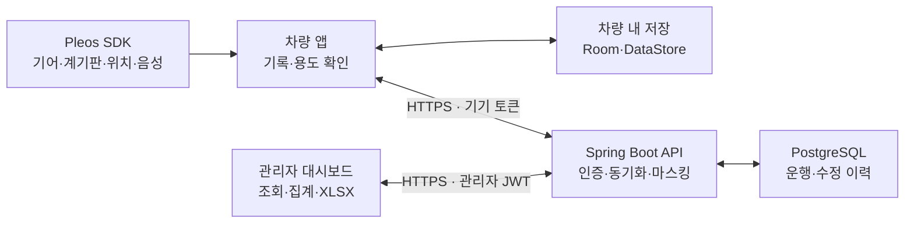

# 아키텍처

> [서비스 소개](../../README.md) · [기술 문서 목차](README.md)

차량 앱은 운행을 기록하고, 서버는 기록을 보호·집계하며, 대시보드는 회사 관리자의 조회·정리를 담당합니다.

## 1. 전체 구조

차량 앱은 Pleos Connect에서 실행합니다. API·DB는 Oracle VM의 Docker Compose로, 대시보드는 Cloudflare Pages로 운영합니다.

## 2. 데이터 흐름

| 단계 | 처리 |
| --- | --- |
| 차량 연결 | 앱이 기기 토큰을 만들고 해시로 등록 코드를 발급받습니다. 관리자가 코드를 입력하면 차량과 기기가 연결됩니다. |
| 운행 감지 | 기어 D/R에서 시작 값, P 유지 후 종료 값을 기록합니다. 출발·도착 위치로 장소를 판정합니다. |
| 용도 확인 | 장소·시간대로 용도를 추정하고 음성·화면으로 확인합니다. 무응답이면 미확인으로 남깁니다. |
| 동기화 | 로컬 저장 후 동의 → 운행 → 수정 → 설정 순서로 전송·수신합니다. UUID로 중복 저장을 막습니다. |
| 관리자 조회 | 서버가 회사 범위를 확인하고 현재 용도에 따라 개인정보를 가린 뒤 JSON·XLSX를 반환합니다. |
| 수정 반영 | 차량·관리자 수정은 서버 이력으로 남고, 관리자 확정은 다음 앱 동기화에 반영됩니다. |

기기 토큰 원문은 HTTPS 인증 헤더에 사용하며, 서버 DB에는 원문 대신 SHA-256 해시를 저장합니다. 앱에서는 Android Keystore로 암호화해 보관합니다.

## 3. 구성 요소 내부 구조

| 구성 | 주요 모듈 | 역할 |
| --- | --- | --- |
| 차량 앱 | `trip`, `purpose`, `voice` | 운행 감지·복원, 장소·용도 추정, 음성·화면 확인 |
| 차량 앱 | `data`, `sync`, `pairing` | 로컬 저장, 전송 큐, 설정 수신, 기기 연결 |
| 차량 앱 | `vehicle`, `location`, `ui`, `export` | SDK 어댑터, 정차 중 화면, CSV |
| 서버 | `auth`, `device`, `global` | 관리자·기기 인증, 페어링, 공통 응답·오류 |
| 서버 | `trip`, `masterdata`, `report` | 운행·수정, 기준정보, 집계·XLSX |
| 대시보드 | `api`, `pages`, `components` | API 클라이언트, 관리 화면, 공통 UI |

서버는 Controller → Service → Repository로 구성하고 DB 변경은 Flyway로 관리합니다. 관리자에게 전달하는 운행 정보는 `TripViewMapper`에서 마스킹합니다. 앱의 감지·추정 로직은 SDK 어댑터와 분리해 단위 테스트합니다.

## 4. 설계 원칙

- **로컬 우선 저장:** 통신 상태와 관계없이 운행을 보존하고 전송을 재시도합니다.
- **자동 기록 보호:** 서버에 저장된 시각·계기판 값은 수정 API에서 변경할 수 없습니다.
- **회사별 분리:** 요청 본문 대신 인증 정보로 회사·차량 범위를 결정합니다.
- **위치 최소 수집:** 완료 운행의 좌표는 장소 판정 후 버리고 집 위치는 차량에만 보관합니다.
- **변경 추적:** 용도 수정에는 주체·전후 값·시각을 남기며 관리자 수정에는 사유가 필요합니다.

## 5. SDK 확인 사항

| SDK | 사용 기능 | 확인한 동작 |
| --- | --- | --- |
| Vehicle 2.3.2 | 기어·계기판, `CAR_DRIVE` 권한 | 현재 값 조회·변경 구독, km 단위 거리 수신 |
| FusedLocation 1.1.3 | 장소 판정, `FUSED_LOCATION` 런타임 권한 | 위치 조회·변경 수신 |
| NaviHelper 3.0.5 | 미등록 장소의 동 이름, `NAVI_ROUTE` 권한 | 내비가 준비된 상태에서 주소 수신 |
| TTS / STT 3.3.1 | `ON_DEVICE` 질문·응답 | TTS 재생, 16kHz·16bit·mono PCM의 한국어 인식 |

TTS 리스너는 초기화 성공 후 등록합니다. 앱과 서비스는 음성 인스턴스 하나를 공유하며, STT의 여러 인식 조각을 모아 답변을 해석합니다. 구현 세부는 [차량 앱](car-app.md), 설치는 [개발·실행 안내](development.md)를 참고하세요.

## 6. 확인 안 된 전제

실제 마이크 입력, 일부 STT 오류 후 복구, AVD 통신망 토글·재부팅의 제약은 [검증 결과](validation.md)에 별도로 기록합니다. PCM 인식 성공을 실제 마이크 검증으로 해석하지 않습니다.

## 7. 운영 도메인·자동 배포

| 항목 | 구성 |
| --- | --- |
| 대시보드 | `https://autolog.aihub.io.kr` · Cloudflare Pages |
| API | `https://autolog-api.aihub.io.kr` · Oracle VM |
| API 경로 | 공통 Nginx → `shared-proxy` → `autolog-api:8080` |
| DB | API 전용 네트워크의 `autolog-db`, 영속 볼륨 사용 |
| 배포 | main의 대상 경로 변경 시 GitHub Actions·Pages가 빌드·배포 |

배포 명령·환경변수·복구 절차는 [운영 안내](../../deploy/README.md)를 따릅니다.
